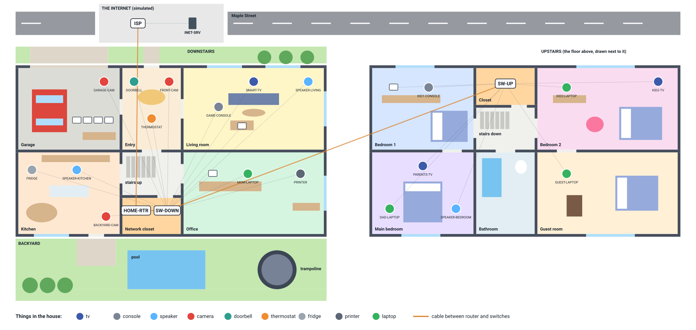

# Home network (Packet Tracer)

Packet Tracer 9.0 project. The file is `House Network.pkt`.

A two floor house with the network a family really has: one router that does everything,
a switch on each floor, and all the things that get plugged in. Not only PCs and laptops,
also smart TVs, game consoles, speakers, security cameras, a video doorbell, a thermostat and
a smart fridge. The canvas in Packet Tracer is drawn as the floor plan of the house, with the
rooms, walls, doors, windows, furniture, the car in the garage and the pool in the backyard.



## In one minute

**The problem.** A house has computers the family trusts and a lot of smart devices nobody
updates. A hacked camera or TV should not be able to reach the family PCs, and a guest should
get the internet and nothing else.

**The design.** One router (HOME-RTR) with one cable to the downstairs switch, carrying every
VLAN (router on a stick). Each kind of device has its own VLAN. The router is the gateway of
every VLAN, hands out the addresses (DHCP), translates to the one public address (NAT) and
decides with ACLs who can reach what.

**Why this way.** It is what a good home router does inside, built out of CCNA parts so every
step can be seen: VLANs and trunks on the switches, subinterfaces, DHCP pools, PAT and
extended ACLs on the router.

## The house

| Room | What is plugged in | VLAN |
|------|--------------------|------|
| Garage | GARAGE-CAM | 20 |
| Entry | DOORBELL, FRONT-CAM, THERMOSTAT | 20 |
| Living room | FAMILY-PC | 10 |
| Living room | SMART-TV, GAME-CONSOLE, SPEAKER-LIVING | 20 |
| Kitchen | FRIDGE, SPEAKER-KITCHEN, BACKYARD-CAM | 20 |
| Office | OFFICE-PC, MOM-LAPTOP, PRINTER | 10 |
| Closet under the stairs | HOME-RTR, SW-DOWN | |
| Bedroom 1 | KID1-PC | 10 |
| Bedroom 1 | KID1-CONSOLE | 20 |
| Bedroom 2 | KID2-LAPTOP | 10 |
| Bedroom 2 | KID2-TV | 20 |
| Main bedroom | DAD-LAPTOP | 10 |
| Main bedroom | PARENTS-TV, SPEAKER-BEDROOM | 20 |
| Guest room | GUEST-LAPTOP | 30 |
| Upstairs closet | SW-UP | |

22 devices in the house: 7 PCs and laptops, a printer, 3 TVs, 2 consoles, 3 speakers,
4 cameras, the doorbell, the thermostat and the fridge.

Packet Tracer has no smart TV, fridge or doorbell, so each of those is a PC with its own picture
(drawn by `tools/pkticons.py` and saved inside the `.pkt` file). It gets an address by DHCP
and answers ping like the real thing.

## Topology

```
                 INET-SRV (198.51.100.10)
                     |
                    ISP           loopback 8.8.8.8
                     |  fiber, 203.0.113.0/30
                 HOME-RTR         2911: gateways, DHCP, NAT, ACLs
                     |  trunk, router on a stick (Gi0/0.10 .20 .30 .99)
                  SW-DOWN         2960, closet under the stairs
                  |     \  trunk up the stairs
         14 devices      SW-UP    2960, upstairs closet
                            \
                             8 devices
```

## VLANs and addresses

| VLAN | Name | Subnet | Gateway | Who |
|------|------|--------|---------|-----|
| 10 | FAMILY | 192.168.10.0/24 | 192.168.10.1 | PCs, laptops, printer |
| 20 | SMART-HOME | 192.168.20.0/24 | 192.168.20.1 | TVs, consoles, speakers, cameras, doorbell, thermostat, fridge |
| 30 | GUEST | 192.168.30.0/24 | 192.168.30.1 | the guest room |
| 99 | MGMT | 192.168.99.0/24 | 192.168.99.1 | SW-DOWN .2, SW-UP .3 |
| 998 | PARKING | | | unused ports, shut down |
| 999 | NATIVE | | | native VLAN of the trunks, nothing in it |

Everything except the switches gets its address from HOME-RTR (`ip dhcp pool FAMILY`,
`SMART-HOME`, `GUEST`). Addresses .1 to .9 are kept out of the pools. The WAN port is
203.0.113.2/30, and every inside address goes out as that one address (PAT).

## Who can reach what

| From | To | Result |
|------|----|--------|
| Family | everything in the house, the internet | allow |
| Smart home | the internet, answers to the family | allow |
| Smart home | starting a connection to a family PC, the guests or MGMT | deny |
| Guest | the internet | allow |
| Guest | anything in the house | deny |
| Internet | anything that the house did not ask for | deny |
| Anyone except Family and MGMT | SSH to the router or a switch | deny |

The ACLs are `SMART-HOME-IN` and `GUEST-IN` (inbound on the subinterfaces, so a packet is
dropped before it is routed), `OUTSIDE-IN` on the WAN port, and the standard ACL 10 on the
vty lines. They are not stateful, so `permit tcp ... established` and `echo-reply` let the
answers back. The full ACLs are at the end of `configs/HOME-RTR.txt`.

## Switches

Same rules on both: port security (sticky, 2 MACs), PortFast and BPDU guard on every device
port, DHCP snooping (only the uplink may answer DHCP), unused ports shut down in VLAN 998,
trunks that only carry 10,20,30,99 with native VLAN 999 and no DTP, Rapid PVST+, SSH version 2
only.

Logins on the router, both switches and the ISP (console included):

    username:       admin
    password:       HomeAdmin
    enable secret:  HomeEnable

## Things to try

| # | Test | Expected |
|---|------|----------|
| 1 | FAMILY-PC `ipconfig` | 192.168.10.x, gateway 192.168.10.1 |
| 2 | SMART-TV `ipconfig`, then FAMILY-PC ping that address | 192.168.20.x, ping works |
| 3 | SMART-TV ping FAMILY-PC | fails (ACL SMART-HOME-IN) |
| 4 | SMART-TV ping 8.8.8.8 | works (NAT on HOME-RTR) |
| 5 | GUEST-LAPTOP ping 8.8.8.8, then ping FAMILY-PC | works, fails |
| 6 | FAMILY-PC browser to 198.51.100.10 | the page of INET-SRV |
| 7 | HOME-RTR `show ip nat translations`, `show ip dhcp binding` | translations, every device with its address |
| 8 | SW-DOWN `show interfaces trunk`, `show vlan brief` | Gi0/1 and Gi0/2 trunking 10,20,30,99 |
| 9 | FAMILY-PC `ssh -l admin 192.168.99.2` (after `crypto key generate rsa` on SW-DOWN) | login works |

## Files

- `House Network.pkt` - the lab
- `configs/` - the config of every router and switch, with comment lines (`! ----`) explaining each part
- `floorplan.svg` - the floor plan above, drawn by `tools/floorplan.py`
- `tools/` - Python programs (standard library only, nothing to install):
  - `houselayout.py` draws the house on the canvas: every device in its room, walls, doors,
    windows, furniture, the pictures of the smart devices and the text notes
  - `pkticons.py` draws those pictures (TV, console, speaker, camera, doorbell, thermostat,
    fridge, printer, laptop) on a 64 x 64 grid and packs them as PNG by hand
  - `pktconfig.py` writes config changes straight into the `.pkt` file, and
    `python3 pktconfig.py check` says whether the lab matches `configs/`
  - `pktfile.py` unpacks and packs the `.pkt` file format
  - `inventory.csv` is every device with its room and VLAN, `plan.csv` the subnets
- `tests/test_house.py` - checks the lab: configs match, every device is in the right VLAN,
  unused ports are shut, the floor plan has no overlaps. Run with `pytest`

The lab was made with the same tools as my RHS school network project.

## Things I am not sure about yet

- The configs are written into the `.pkt` file by `pktconfig.py`, not typed into the devices.
  They have to be checked in Packet Tracer (the tests in the table above, the results are not
  filled in yet)
- no wireless: in a real house most of these devices are on Wi-Fi. Here everything is wired so
  the VLANs and ACLs are easy to see
- the consoles are in the smart home VLAN. A family that plays online with friends in the house
  might want them in FAMILY
